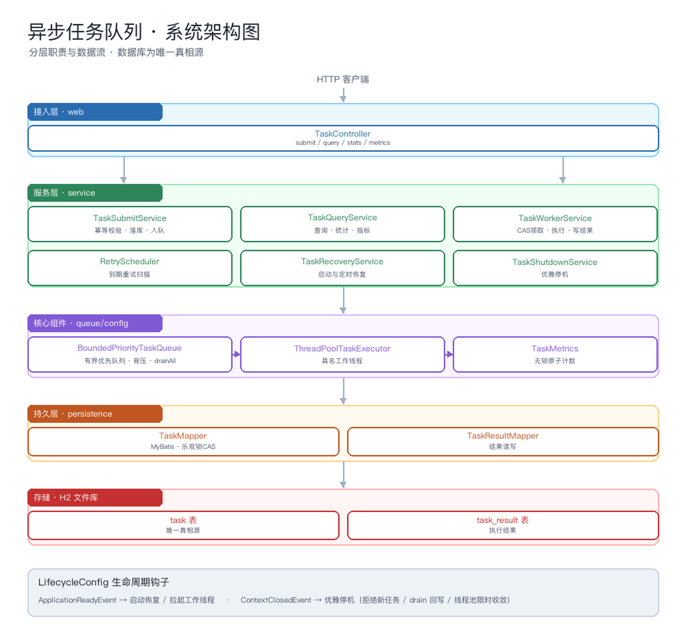
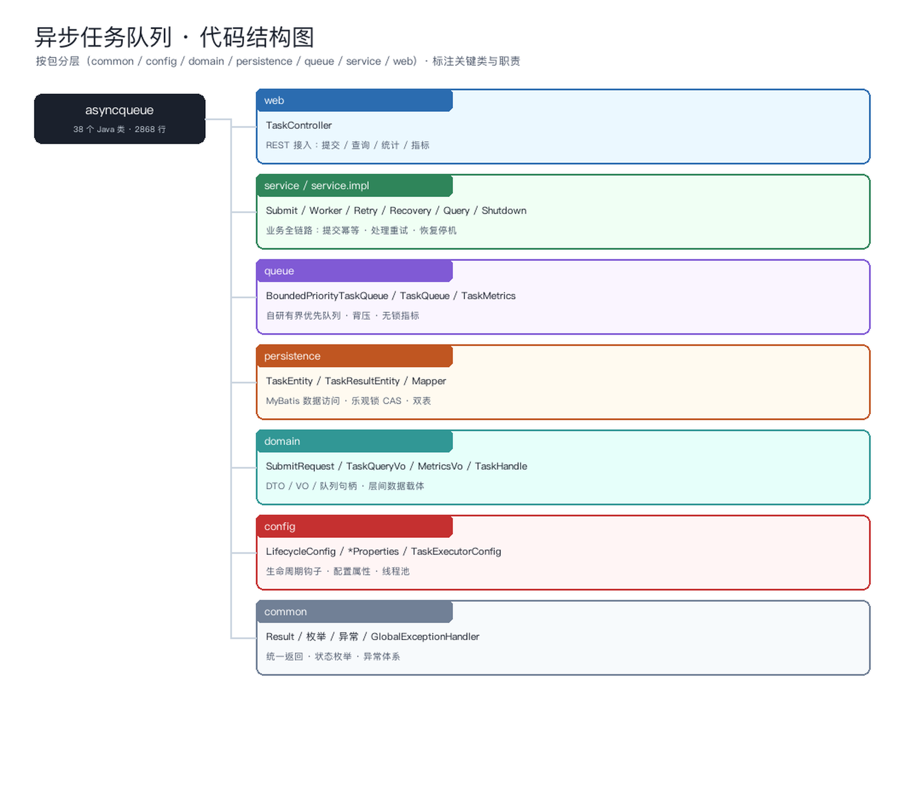
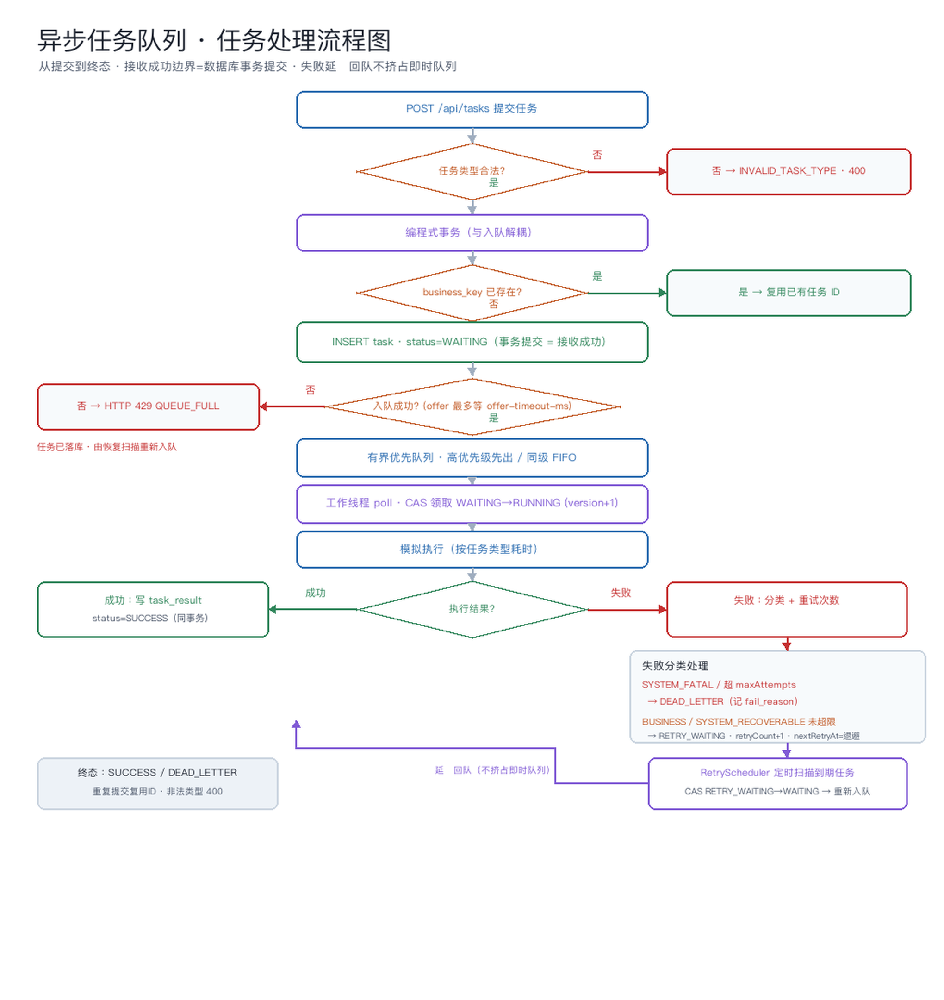

# 异步任务队列（Java 17 + Spring Boot 3.3 + MyBatis + H2）

面向 AI 应用场景的自研异步任务队列，覆盖题目全部核心要求：任务建模、接收、有界排队、优先级、处理、失败重试与幂等、状态与结果查询、优雅停机、可观测性。代码遵循阿里巴巴 Java 开发手册规范。

## 一、场景与任务模型

选择 **AI 应用方向** 的三个典型任务，耗时特征决定并发模型：

| 任务类型 | 场景 | 耗时特征 | 并发模型 |
|---|---|---|---|
| `DOCUMENT_SUMMARY` | LLM 文档摘要 | IO 密集（等待模型服务），400~1200ms | 线程池，线程数不宜过多 |
| `VECTOR_EMBEDDING` | 向量化嵌入 | CPU+IO 混合，200~600ms | 线程池，适度并发 |
| `RULE_CHECK` | 本地规则校验 | CPU 密集，50~150ms | 线程池，线程数≈CPU 核数 |

任务结构见 `TaskEntity`：`businessKey`（幂等键）、`taskType`、`payload`、`priority`、`status`、`retryCount`、`maxAttempts`、`nextRetryAt`、`failReason`、`version`（乐观锁）等。

由于三类任务均为「等待型」而非纯 CPU 计算，统一采用固定大小线程池并发，避免为每个任务创建线程带来的上下文切换开销。

## 二、系统架构图

如下图按分层展示模块职责与数据流。接入层只做校验与路由，服务层承载全部业务规则，核心组件层是自研队列、线程池与无锁指标，持久层通过 MyBatis 操作 H2。**数据库是唯一真相源**，内存队列只是加速调度的有界窗口；`LifecycleConfig` 在应用就绪与容器关闭两个时间点驱动恢复与停机。



## 三、代码结构图

代码按职责分包，共 38 个 Java 类（约 2868 行），自顶向下依赖：`web → service → queue / persistence → domain / common`，`config` 横切生命周期与线程池配置。



| 包 | 职责 | 关键类 |
|---|---|---|
| `web` | REST 接入，不含业务逻辑 | `TaskController` |
| `service` / `service.impl` | 提交幂等、处理重试、恢复停机全链路 | `TaskSubmitService`、`TaskWorkerService`、`RetryScheduler` 等 |
| `queue` | 自研有界优先队列、背压、无锁指标 | `BoundedPriorityTaskQueue`、`TaskMetrics` |
| `persistence` | MyBatis 数据访问、乐观锁 CAS、双表 | `TaskMapper`、`TaskEntity` |
| `domain` | DTO / VO / 队列句柄，层间数据载体 | `SubmitRequest`、`TaskQueryVo`、`TaskHandle` |
| `config` | 生命周期钩子、配置属性、线程池 | `LifecycleConfig`、`TaskExecutorConfig` |
| `common` | 统一返回、枚举、异常体系 | `Result`、`TaskStatusEnum`、`GlobalExceptionHandler` |

## 四、任务处理流程图

从提交到终态的完整链路。三个关键点：**接收成功的边界是数据库事务提交而非入队成功**；入队失败与重试入队失败都不删库，由恢复扫描兜底；失败不直接回队列，而是落库 `RETRY_WAITING` + `nextRetryAt`，由调度器延迟 CAS 回队，避免失败瞬间放大队列压力。



## 五、核心设计

### 1. 任务不丢失（最重要）

**数据库是唯一真相源**，内存队列只是「加速调度的有界窗口」。

- 提交时先用编程式事务把任务以 `WAITING` 状态落库，**事务提交成功即「接收成功」**；随后才入内存队列。
- 入队失败（背压拒绝）时任务仍留在数据库，由恢复扫描兜底重新入队。
- 内存队列中未处理的任务，在优雅停机时 drain 出来并回写数据库（保持 `WAITING`）。
- 进程重启后，`TaskRecoveryService` 扫描 `WAITING` 与超时 `RUNNING` 任务重新入队。

流转路径：`WAITING → RUNNING → SUCCESS / DEAD_LETTER`，失败可经 `RETRY_WAITING → WAITING` 重试。

### 2. 幂等

- `task.business_key` 建唯一索引；同一业务键重复提交直接返回已有任务 ID。
- 并发提交冲突时捕获 `DuplicateKeyException` 后回查复用，避免重复任务。
- 工作线程领取任务使用乐观锁 CAS（`version`），防止恢复扫描造成重复执行。

### 3. 容量决策与背压

- **容量公式**：`队列容量 = 核心线程数 × 容量系数`（默认 4 × 8 = 32），系数可按消费速率与下游耗时配置，无需改代码。
- **背压策略**：队列满时 `offer` 最多等待 `offer-timeout-ms`（默认 50ms），超时返回 false，接口返回 **HTTP 429 + `QUEUE_FULL`**，明确拒绝，不无限放大队列压力。
- 自研队列 `BoundedPriorityTaskQueue` 基于 `PriorityQueue + ReentrantLock + 双 Condition`，不引入任何队列中间件。

### 4. 失败分类与重试

| 分类 | 说明 | 处理 |
|---|---|---|
| `BUSINESS` | 任务自身业务异常 | 次数上限 + 指数退避重试 |
| `SYSTEM_RECOVERABLE` | 系统可恢复异常（依赖抖动） | 次数上限 + 指数退避重试 |
| `SYSTEM_FATAL` | 系统不可恢复异常（代码缺陷/非法参数） | 直接死信，不重试 |

- 重试不直接入队，而是落库为 `RETRY_WAITING` + `nextRetryAt`，由 `RetryScheduler` 扫描到期后 CAS 抢占重新入队，**避免失败瞬间放大队列压力**。
- 退避公式：`base × 2^(n-1)`，不超过上限（默认 200ms 起，上限 5s）。
- 超过 `maxAttempts`（默认 3）进入 `DEAD_LETTER`，记录失败原因与分类。
- 未预期的异常统一按 `SYSTEM_RECOVERABLE` 处理。

### 5. 优雅停机

`LifecycleConfig` 监听 `ContextClosedEvent`，执行 `TaskShutdownService.shutdown()`：

1. 标记停机，接口拒绝新任务；
2. 停止工作线程取新任务、停止重试调度与恢复扫描；
3. drain 内存队列，把未处理任务回写数据库（保持 `WAITING`）；
4. 线程池限时收敛（默认 10s），超时则强制关闭并记录。

### 6. 可观测性

`GET /api/tasks/metrics` 暴露：队列长度/容量、活跃线程数、池大小、成功/失败/重试/死信计数、平均排队时长、平均处理时长、各状态数量。统计使用无锁原子计数，避免统计本身成为热点。

## 六、接口

| 方法 | 路径 | 说明 |
|---|---|---|
| POST | `/api/tasks` | 提交任务，返回任务 ID（JSON body 见 `SubmitRequest`） |
| GET | `/api/tasks/{taskId}` | 查询状态、结果、失败原因、重试次数、耗时 |
| GET | `/api/tasks/stats` | 按状态统计数量（积压/处理中/成功/失败/死信） |
| GET | `/api/tasks/metrics` | 可观测性指标 |

提交示例：

```bash
curl -X POST http://localhost:8080/api/tasks \
  -H 'Content-Type: application/json' \
  -d '{"businessKey":"doc-001","taskType":"DOCUMENT_SUMMARY","payload":"摘要这段文本","priority":8}'
```

> 测试技巧：`payload` 含 `FORCE_FAIL` 模拟可重试的业务失败；含 `FATAL_ERROR` 模拟不可恢复失败（直接死信）。

## 七、如何运行

```bash
# 无需本地安装 Maven，Wrapper 自动使用 Maven 3.9.9
./mvnw spring-boot:run

# 运行测试
./mvnw test

# 打包
./mvnw package
```

H2 使用文件持久化模式（`./data/taskdb.mv.db`），重启数据保留；DDL 见 `src/main/resources/schema.sql`，启动自动建表。任务状态表 `task` 与结果表 `task_result` 分离，便于查询与清理。

## 八、测试覆盖

- `BoundedPriorityTaskQueueTest`：有界容量、背压拒绝、优先级与 FIFO、drainAll、并发生产消费不丢任务。
- `RetryPropertiesTest`：指数退避与上限。
- `TaskSubmitIntegrationTest`：提交落库、业务键幂等。
- `ShutdownRecoveryIntegrationTest`：优雅停机后任务不丢失、内存队列回写。

## 九、代码规范

遵循阿里巴巴 Java 开发手册：包名全小写、类名大驼峰、常量全大写、枚举以 `Enum` 结尾、覆写方法加 `@Override`、POJO 布尔属性不加 `is` 前缀、序列化类显式 `serialVersionUID`、集合初始化指定容量、日志使用 SLF4J 占位符、事务边界在 Service 层、DTO/DO/VO 分层、统一异常处理、禁止魔法值。关键对话见 `docs/ai-dialogue.md`。
